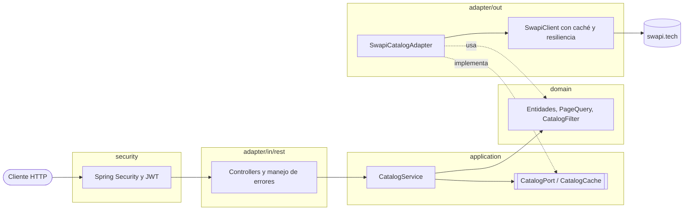
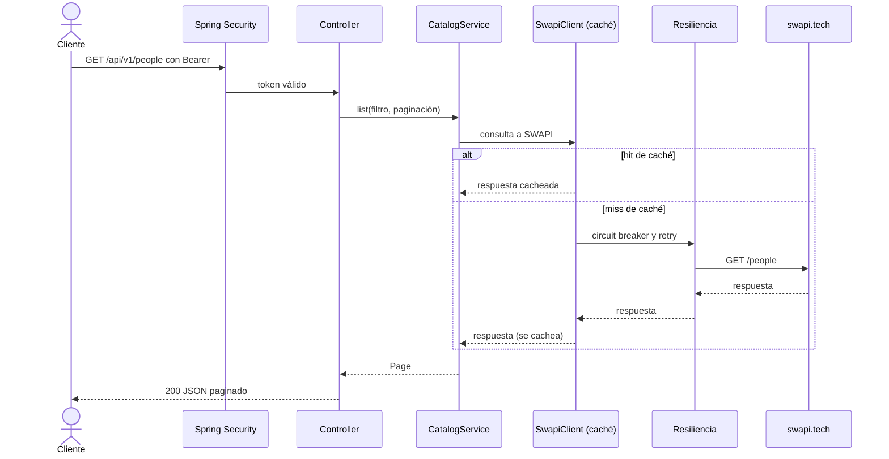

# Star Wars Catalog API

API REST en Java 21 y Spring Boot 4 que expone el catálogo de personajes, películas, naves y vehículos de [swapi.tech](https://www.swapi.tech): paginado, filtrable por id y nombre, protegido con JWT y roles, con caché, resiliencia ante fallas de SWAPI y documentación OpenAPI.


## Probalo en 2 minutos

```bash
export BASE_URL=RENDER_URL
```

> **Arranque en frío.** La API corre en el plan gratuito de Render: se duerme a los 15 minutos sin tráfico y el primer request tarda alrededor de un minuto en despertarla. Pegale primero a `$BASE_URL/actuator/health` y esperá el `200`.

Usuarios de demostración (públicos a propósito, para que cualquiera pueda probar; ver [Usuarios demo en producción](#usuarios-demo-en-producción)):

| Usuario | Contraseña | Roles |
|---|---|---|
| `user` | `user-password` | `USER` |
| `admin` | `admin-password` | `USER`, `ADMIN` |

Login, guardando el token en una variable (requiere `jq`):

```bash
TOKEN=$(curl -s -X POST "$BASE_URL/api/v1/auth/login" \
  -H 'Content-Type: application/json' \
  -d '{"username":"user","password":"user-password"}' | jq -r .accessToken)
```

Listado de personajes:

```bash
curl -s "$BASE_URL/api/v1/people?page=1&size=3" -H "Authorization: Bearer $TOKEN"
```

Filtro por nombre (coincidencia parcial, sin distinguir mayúsculas), por id y por título de película:

```bash
curl -s "$BASE_URL/api/v1/people?name=luke" -H "Authorization: Bearer $TOKEN"
curl -s "$BASE_URL/api/v1/people?id=1" -H "Authorization: Bearer $TOKEN"
curl -s "$BASE_URL/api/v1/films?name=hope" -H "Authorization: Bearer $TOKEN"
```

Detalle de un personaje (`404` si no existe):

```bash
curl -s "$BASE_URL/api/v1/people/1" -H "Authorization: Bearer $TOKEN"
```

- Swagger UI: `$BASE_URL/swagger-ui.html` (botón **Authorize** con el token del login).
- Colección de Bruno con el recorrido completo: [`bruno/`](bruno) (ver [Tests y calidad](#tests-y-calidad)).

## Cumplimiento del enunciado

Cada requisito de [`CHALLENGE.md`](CHALLENGE.md), dónde se resuelve y cómo se prueba. La especificación con todos los escenarios está en [`docs/spec.md`](docs/spec.md).

| Requisito | Dónde se resuelve | Cómo se prueba |
|---|---|---|
| 1. Integración con la API de Star Wars | `adapter/out/swapi`: `SwapiClient` (`RestClient`, timeouts, caché, resiliencia), `SwapiCatalogAdapter` y los mappers | `SwapiClientTest` y `SwapiCatalogAdapterTest` contra WireMock; `CatalogEndToEndTest` con la app completa |
| 2. Listado paginado de People, Films, Starships y Vehicles | `PeopleController`, `FilmsController`, `StarshipsController` y `VehiclesController`; paginación en `domain/page` | `*ControllerTest`, `InMemoryPaginatorTest`, `PageQueryTest` y `CatalogEndToEndTest`. A mano: `GET /api/v1/people?page=2&size=10` |
| 3. Filtrado por id y/o nombre | `CatalogFilter` (dominio) y `CatalogService`; parámetros `id` y `name` en los cuatro recursos | `CatalogFilterTest`, `CatalogServiceTest`, `SwapiCatalogAdapterTest`. A mano: los `curl` de [Probalo en 2 minutos](#probalo-en-2-minutos) |
| 4. Autenticación y autorización | Paquete `security`: login con JWT (`LoginService`, `TokenService`), roles `USER` y `ADMIN` en `SecurityConfig` | `AuthControllerTest`, `TokenServiceTest`, `LoginServiceTest`, `JwtSecretValidationTest`, `ProblemDetailsRealServerTest`. A mano: un `401` sin token y un `403` de `USER` en `DELETE /api/v1/admin/cache` |
| 5. Documentación de uso y de código | Este README, [`docs/spec.md`](docs/spec.md), los [ADR](docs/adr/README.md), Swagger UI y Javadoc en el código público | `./mvnw javadoc:javadoc` y Swagger UI en `/swagger-ui.html`. Un clone limpio se levanta siguiendo [Correr localmente](#correr-localmente) |
| 6. Pruebas unitarias y de integración | `src/test`: ver [Tests y calidad](#tests-y-calidad) | `./mvnw verify` (más de 300 tests y el piso de cobertura) |
| 7. Despliegue | `Dockerfile`, `render.yaml` (Render, plan gratuito) y CI en `.github/workflows/ci.yml` | El job `docker` del CI construye la imagen y consulta `/actuator/health`. A mano: la URL de [Probalo en 2 minutos](#probalo-en-2-minutos) |
| Restricción: Java 21 y Spring Boot | `pom.xml`: Java 21 y Spring Boot 4.1 | El enforcer corta el build con otro JDK |

## Correr localmente

Requisitos, según cómo lo corras:

- **Docker (Compose):** no necesita nada más; el JDK está dentro de la imagen.
- **Maven (`./mvnw`):** necesita **Java 21** instalado (`java -version` tiene que informar 21). El wrapper evita instalar Maven, no el JDK: con otro JDK el build se corta con un mensaje del enforcer.

Sin `JWT_SECRET` la aplicación no arranca a propósito.

Con Docker Compose:

```bash
export JWT_SECRET=$(openssl rand -base64 48)
docker compose up --build
```

Con Maven (Java 21):

```bash
export JWT_SECRET=$(openssl rand -base64 48)
./mvnw spring-boot:run
```

En ambos casos la API queda en `http://localhost:8080` (usá `export BASE_URL=http://localhost:8080` y los mismos `curl` de arriba). Para bajar Compose: `JWT_SECRET=x docker compose down`.

## API

| Método y ruta | Auth | Respuesta |
|---|---|---|
| `POST /api/v1/auth/login` `{username, password}` | Pública | `200 {accessToken, tokenType: "Bearer", expiresIn}` |
| `GET /api/v1/{people\|films\|starships\|vehicles}?page&size&id&name` | `USER` o `ADMIN` | `200 {content[], page, size, totalElements, totalPages}` |
| `GET /api/v1/{people\|films\|starships\|vehicles}/{id}` | `USER` o `ADMIN` | `200` entidad |
| `DELETE /api/v1/admin/cache` | `ADMIN` | `204` |
| `GET /actuator/health` | Pública | Salud |
| `GET /actuator/metrics/**` | `ADMIN` | Métricas (caché, Resilience4j, HTTP) |
| `/swagger-ui.html`, `/swagger-ui/**`, `/v3/api-docs/**` | Pública | Swagger UI y contrato OpenAPI |

Parámetros del listado:

| Parámetro | Regla |
|---|---|
| `page` | Base 1, default `1`, sin máximo |
| `size` | Entre `1` y `100`, default `10` |
| `id` | Entero positivo |
| `name` | Coincidencia parcial sin distinguir mayúsculas; en `films` filtra por título. Un valor en blanco se ignora |

Respuesta paginada (abreviada):

```json
{
  "content": [
    {
      "id": "1",
      "name": "Luke Skywalker",
      "gender": "male",
      "birthYear": "19BBY",
      "height": 172,
      "mass": 77.0,
      "hairColor": "blond",
      "skinColor": "fair",
      "eyeColor": "blue",
      "homeworldId": "1",
      "filmIds": ["1", "2", "3", "6"],
      "starshipIds": ["12", "22"],
      "vehicleIds": ["14", "30"]
    }
  ],
  "page": 1,
  "size": 1,
  "totalElements": 82,
  "totalPages": 82
}
```

Los atributos numéricos de SWAPI (que llegan como texto) se exponen como números y los valores desconocidos (`unknown`, `n/a`, `none`, vacío o no interpretables) como `null`. Las relaciones se exponen como ids.

**Semántica de los filtros**

- Sin filtros: la paginación se delega a SWAPI, salvo en `films`, que no pagina y se pagina en memoria.
- Solo `name`: se buscan las coincidencias en SWAPI y se paginan en memoria.
- Solo `id`: se consulta el detalle y se devuelve una página de 0 o 1 elemento.
- `id` y `name`: se consulta el id y se conserva solo si el nombre coincide.
- Un `id` inexistente como filtro devuelve `200` con página vacía (`totalElements: 0`); en el detalle (`GET /{recurso}/{id}`) devuelve `404`.
- Una página fuera de rango devuelve `200` con `content` vacío y los totales reales.
- El orden es el que entrega SWAPI; la API no reordena.

**Errores.** Todos usan Problem Details (RFC 9457, `application/problem+json`):

| Estado | Cuándo |
|---|---|
| `400` | Parámetro inválido (`page`, `size`, `id`, `name` de más de 100 caracteres), cuerpo de login inválido o JSON malformado; nombra el parámetro o campo cuando corresponde |
| `401` | Sin token, token inválido o vencido, o credenciales incorrectas; siempre con `WWW-Authenticate: Bearer` |
| `403` | Token válido sin el rol necesario |
| `404` | Detalle de un id inexistente o ruta inexistente |
| `405` | Método no soportado; incluye el header `Allow` |
| `500` | Error inesperado; respuesta genérica, sin detalles internos |
| `502` | SWAPI respondió 5xx de forma persistente o una respuesta inesperada |
| `503` | SWAPI no disponible (timeout, conexión, cupo agotado o circuito abierto); incluye `Retry-After` en segundos |

Los `502` y `503` se loguean con el `requestId` (el mismo `X-Request-Id` de la respuesta), igual que los `500`.

**Límites de tamaño.** `name` admite hasta 100 caracteres; `username` y `password` del login, hasta 72 (el máximo que BCrypt procesa). Por encima de eso la respuesta es `400`.

```json
{
  "title": "Bad Request",
  "status": 400,
  "detail": "Invalid parameter 'size': size must be between 1 and 100",
  "instance": "/api/v1/people",
  "parameter": "size"
}
```

## Configuración

Las propiedades viven en `src/main/resources/application.yml` y se pueden sobrescribir con variables de entorno (binding relajado de Spring: `swapi.read-timeout` es `SWAPI_READ_TIMEOUT`).

| Variable o propiedad | Default | Descripción |
|---|---|---|
| `JWT_SECRET` | sin default, **obligatoria** | Secreto HS256 de al menos 32 bytes. Si falta o es corto, la aplicación no arranca |
| `PORT` | `8080` | Puerto HTTP |
| `SPRING_PROFILES_ACTIVE` | vacío | Con `prod`, los logs salen en JSON con formato ECS |
| `app.security.jwt.issuer` | `starwars-catalog-api` | Claim `iss` de los tokens |
| `app.security.jwt.expiration` | `1h` | Vigencia del token (`expiresIn` en segundos) |
| `app.security.users` | `user` y `admin` | Usuarios con `username`, `password-hash` (BCrypt) y `roles`; ver [Usuarios demo en producción](#usuarios-demo-en-producción) |
| `swapi.base-url` | `https://www.swapi.tech/api` | URL base de SWAPI |
| `swapi.connect-timeout` | `2s` | Timeout de conexión |
| `swapi.read-timeout` | `5s` | Timeout de lectura |
| `swapi.default-retry-after` | `30s` | `Retry-After` cuando SWAPI no informa cuándo reintentar |
| `spring.cache.caffeine.spec` | `maximumSize=500,expireAfterWrite=1h,recordStats` | Tamaño y TTL de la caché |
| `resilience4j.retry.instances.swapi` | 3 intentos, espera de `200ms` con backoff exponencial (x2) | Reintentos: solo 5xx y fallas de conexión |
| `swapi.max-retry-after` | `15m` | Tope del `Retry-After` calculado desde `x-ratelimit-reset` de SWAPI |
| `resilience4j.circuitbreaker.instances.swapi` | ventana de 10 llamadas, mínimo 5, umbral 50 %, abierto `30s`, 3 llamadas en semiabierto | Circuit breaker: cuenta 5xx, timeouts, fallas de conexión y respuestas inválidas; el `429` no cuenta |
| `springdoc.swagger-ui.path` | `/swagger-ui.html` | Ruta de Swagger UI |

### Usuarios demo en producción

Los usuarios `user` y `admin` están activos también en la instancia desplegada. Es una decisión consciente: quien revisa la API tiene que poder probar la autorización (un `403` de `USER`, el vaciado de caché y las métricas de `ADMIN`) en la URL pública. Lo peor que permite `admin` es vaciar la caché y ver métricas. En un uso real se reemplazan por configuración, incluso con variables de entorno (binding relajado de Spring; el hash es BCrypt):

```bash
export APP_SECURITY_USERS_0_USERNAME=ops
export APP_SECURITY_USERS_0_PASSWORDHASH='<hash BCrypt>'
export APP_SECURITY_USERS_0_ROLES_0=USER
export APP_SECURITY_USERS_0_ROLES_1=ADMIN
```

Una lista definida por entorno reemplaza a la del `application.yml` completa, así que los usuarios demo dejan de existir. Ver el [ADR 0004](docs/adr/0004-autenticacion-jwt.md).

## Tests y calidad

```bash
./mvnw verify
```

Corre toda la suite (más de 300 tests) y el chequeo de cobertura. Requiere Java 21. Ningún test le pega a SWAPI: todos usan fakes o WireMock.

| Nivel | Qué cubre |
|---|---|
| Unitarios de dominio y casos de uso | Paginación, filtros, parseo de valores y mappers, `CatalogService` con un fake del puerto, emisión de JWT, filtro de correlación |
| Integración del cliente | `SwapiClient` y adaptador contra WireMock: mapeo, timeouts, reintentos, circuit breaker y caché (incluida la concurrencia sobre una misma consulta) |
| Capa web | Controllers con MockMvc y la seguridad real (login, roles, tokens inválidos, Problem Details) |
| Punta a punta | La aplicación completa contra WireMock: login, listados, caché, Actuator y Swagger |
| Arquitectura | 5 reglas de ArchUnit sobre las dependencias entre paquetes (ver [Arquitectura](#arquitectura)) |

**Cobertura.** JaCoCo exige, por paquete de `domain*` y `application*`, al menos 80 % de líneas y 70 % de ramas, y el build falla si no se cumple. Hoy `domain` y `application` tienen 100 % de líneas, y el proyecto completo está alrededor de 98 % de líneas y 92 % de ramas. El reporte queda en `target/site/jacoco/index.html` y el CI lo publica como artifact.

**Colección de Bruno.** En [`bruno/`](bruno) hay 21 requests que recorren login, listados, filtros, detalle, errores, administración y operación. Contra una API corriendo en local:

```bash
npm i -g @usebruno/cli
cd bruno && bru run -r --env local
```

Algunos asserts dependen de los datos actuales de SWAPI (por ejemplo, totales de cada recurso); si el servicio cambia sus datos pueden requerir ajuste. El entorno `render` apunta a la URL desplegada.

## Arquitectura

Arquitectura hexagonal acotada al borde con SWAPI: `application` define puertos de salida (`application/port/out`) que implementa `adapter/out`, y no hay puertos de entrada (los controllers llaman directo a los casos de uso). El dominio y los casos de uso no conocen frameworks ni HTTP.



Por qué así: la única integración externa con comportamiento propio es SWAPI (formatos irregulares, paginación inconsistente, cupo de requests, caídas). Aislarla detrás de puertos permite testear los casos de uso con un fake y reemplazar el origen de datos sin tocar la lógica. Los puertos incluyen sus excepciones (`CatalogUnavailableException` y `CatalogUpstreamException`, que las `Swapi*Exception` extienden), de modo que la capa web traduce errores sin conocer a SWAPI.

Cinco reglas de ArchUnit (`ArchitectureTest`) hacen cumplir la estructura en cada build:

1. `domain` no depende de Spring, Jackson, `adapter` ni `application`.
2. `application` no depende de Spring, Jackson ni `adapter`.
3. `domain` y `application` no dependen de Jakarta, Resilience4j, Caffeine, `security` ni `config`.
4. `adapter.in` no depende de `adapter.out`.
5. `adapter.out` no depende de `adapter.in` ni de `security`.

Ver [ADR 0002](docs/adr/0002-arquitectura.md).

```
io.github.lionesp.starwarscatalog
├── domain          entidades (records), PageQuery, Page, CatalogFilter, paginación en memoria
├── application     CatalogService, CacheAdminService y puertos de salida (CatalogPort, CatalogCache) con sus excepciones
├── adapter
│   ├── in/rest     controllers, DTO de la API, manejo de errores, filtro de correlación
│   └── out
│       ├── swapi   SwapiClient, SwapiResilience, SwapiCatalogAdapter, DTO y mappers
│       └── cache   CaffeineCatalogCache
├── security        cadenas de Spring Security, login (`LoginService`), emisión de JWT, usuarios
└── config          composición de beans, caché y OpenAPI
```

## Decisiones de diseño

Un listado atraviesa estas capas; la caché queda por fuera de la resiliencia, así un hit no consume cupo de SWAPI ni cuenta en el circuit breaker:



| Decisión | ADR |
|---|---|
| Java 21, Spring Boot 4.1, Maven, virtual threads y `RestClient` | [0001](docs/adr/0001-stack.md) |
| Hexagonal acotada al borde con SWAPI, con reglas de ArchUnit | [0002](docs/adr/0002-arquitectura.md) |
| Proxy con caché en lugar de snapshot en memoria | [0003](docs/adr/0003-proxy-con-cache.md) |
| JWT HS256 con Spring Security; usuarios demo también en producción | [0004](docs/adr/0004-autenticacion-jwt.md) |
| Orden caché, circuit breaker y retry; 502 vs 503 | [0005](docs/adr/0005-resiliencia.md) |
| Números tipados, desconocidos a `null`, relaciones como ids | [0006](docs/adr/0006-tipado-de-datos.md) |
| Deploy en Render con Docker; arranque y memoria | [0007](docs/adr/0007-deploy-en-render.md) |

Trampas de SWAPI que el diseño resuelve:

- **Página fuera de rango.** `?page=99` responde `200` con la última página en lugar de vacío; la API detecta el caso y devuelve una página vacía con los totales reales.
- **`name` ignorado en `films`.** SWAPI filtra películas por `title`; el parámetro `name` se traduce en el adaptador y el filtro es el mismo en los cuatro recursos.
- **Dos envoltorios.** `results` en el listado paginado y `result` en búsqueda, detalle y `films`; ambos producen las mismas entidades.
- **Todo como texto.** Números, fechas y relaciones (URLs) llegan como cadenas; se tipan en los mappers.
- **Cupo de 100 requests por ventana.** La caché con TTL de 1 hora, `sync` y el 404 cacheado protegen el cupo; si se agota, la API responde `503` con `Retry-After`.

## Supuestos

- Los usuarios son predefinidos por configuración; no hay registro ni base de datos.
- `USER` lee el catálogo; `ADMIN` además vacía la caché y consulta métricas.
- Los datos de SWAPI cambian poco: un TTL de 1 hora es aceptable y las ediciones del origen pueden tardar hasta ese tiempo en reflejarse (o hasta vaciar la caché).
- Un valor numérico que no se puede interpretar se expone como `null`; nunca hace fallar el request.
- `page` no tiene máximo: una página más allá del final devuelve una página vacía con los totales.
- Las credenciales demo son públicas a propósito y siguen activas en producción (ver [Usuarios demo en producción](#usuarios-demo-en-producción)). El secreto JWT nunca está en el repositorio.

## Trade-offs y qué haría con más tiempo

- **Rate limiting propio y protección contra fuerza bruta en el login.** Hoy el único límite es el de SWAPI; sumaría un límite por usuario/IP y bloqueo progresivo de intentos fallidos.
- **Refresh tokens y revocación.** Los tokens duran una hora y no se pueden invalidar antes; con más tiempo agregaría refresh tokens y una lista de revocación.
- **Caché distribuida.** La caché es local a cada instancia; con más de una instancia habría que pasar a Redis u otra caché compartida.
- **Expandir relaciones.** Las relaciones se exponen solo como ids; sería natural ofrecer un parámetro de expansión.
- **Contract tests contra SWAPI.** Los tests usan WireMock con fixtures; un chequeo periódico contra el servicio real detectaría cambios de formato.
- **Tracing distribuido.** Hay un id de correlación en logs, pero no trazas entre servicios.
- **Pinning de virtual threads con `sync = true`.** `@Cacheable(sync = true)` carga el valor dentro de un `synchronized`, y en Java 21 eso fija el hilo portador de un virtual thread mientras espera a SWAPI. Con cuatro recursos y un cupo de 100 requests el riesgo es bajo; si creciera, lo resolvería con una caché asíncrona. Ver [ADR 0003](docs/adr/0003-proxy-con-cache.md).
- **`Retry-After` como cota superior con el breaker abierto.** Informa la espera configurada completa (30 s), aunque el breaker pueda pasar a semiabierto antes: es una cota segura y evita calcular el tiempo restante. Ver [ADR 0005](docs/adr/0005-resiliencia.md).
- **Persistencia propia.** No guardo datos de SWAPI; es una elección de simplicidad, a costa de depender de su disponibilidad (mitigada con caché y resiliencia).

## Uso de IA

Desarrollé el proyecto con asistencia de Claude Code (los commits lo indican con `Co-Authored-By`). La usé dentro de un proceso con control propio en cada paso:

- **[Spec primero](docs/spec.md).** Antes de escribir código fijé el contrato de la API y los escenarios verificables (entrada → salida esperada), incluidas las trampas de SWAPI que verifiqué con `curl`. Esa especificación está publicada y cada escenario tiene al menos un test. La revisé críticamente antes de implementar y después, lo que sumó casos que había pasado por alto (por ejemplo, que un token vencido no debía bloquear el login).
- **Tests guiados por los escenarios.** Los escenarios de la spec definieron qué probar en cada capa, y los tests corren en cada `./mvnw verify`.
- **Revisión de cada diff.** Corrí la verificación por mi cuenta y rechacé o pedí corregir lo que no cumplía: código de producción que existía solo para los tests, configuraciones de test que se colaban en el contexto completo, imports con comodín.
- **Decisiones propias.** Las decisiones de diseño y sus alternativas están en los [ADR](docs/adr/README.md), y puedo defender cada una.

## Convenciones del repo

Código, Javadoc y tests en inglés; documentación y mensajes de commit en español.
